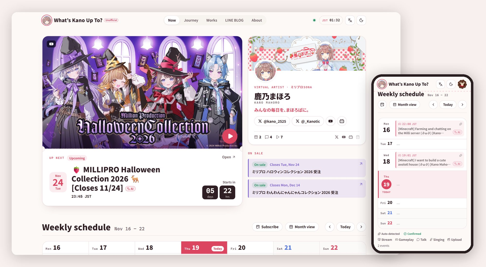
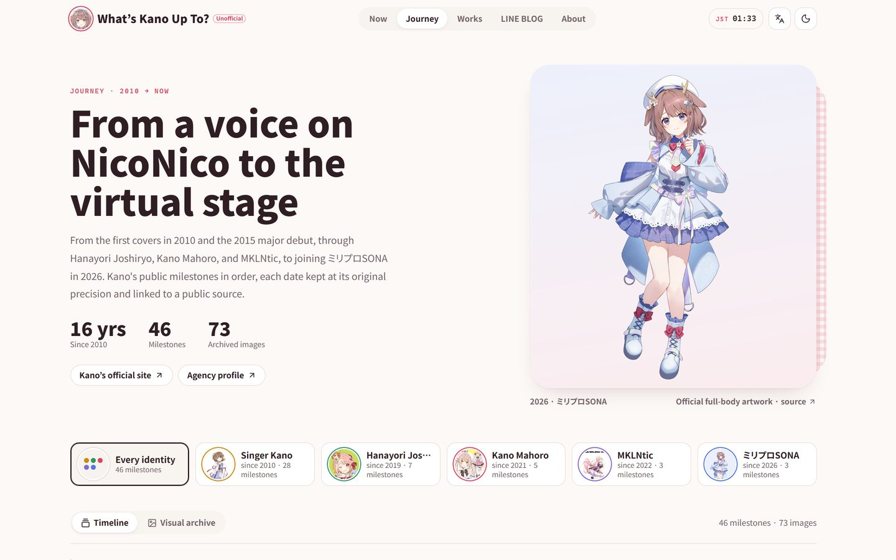
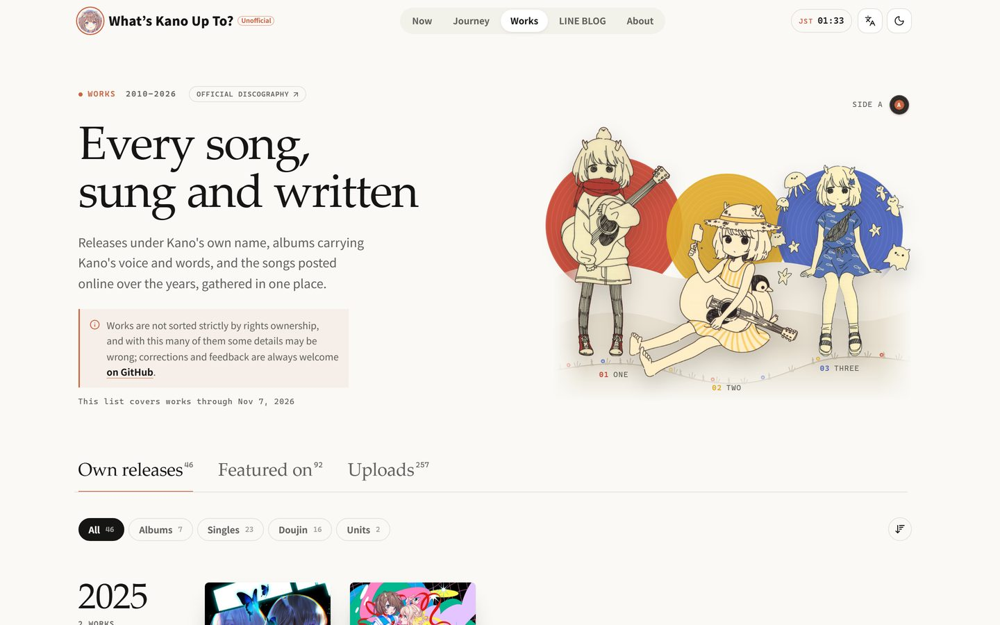

  

<h1 align="center">Kano Navi</h1>

  <b>鹿乃ちゃん何してるか</b> ― 鹿乃まほろの非公式ファンボード。

  <a href="https://kano.fans/"><b>kano.fans</b></a>（日本サーバー）·
  <a href="https://xiaolubao.com/"><b>xiaolubao.com</b></a>（中国大陸サーバー・提供：<a href="https://github.com/kanomahoro1224">鹿可可</a>）

  
  
  

  <a href="README.md">English</a> · <a href="README.zh-CN.md">简体中文</a> · 日本語

   
  ライトテーマの日本サーバーのスクリーンショット（2026年11月19日 JST 撮影）。

> [!NOTE]
> Kano Navi は独立したファンプロジェクトであり、鹿乃まほろ本人、所属事務所、X、YouTube、bilibili、および LINE とは一切関係なく、公式の承認を受けたものでもありません。常に公式の元の告知が優先されます。

## サイト内のページ

| ページ        | 内容                                                                                                                       |
| ------------- | -------------------------------------------------------------------------------------------------------------------------- |
| **いま**      | 次回の配信までのカウントダウン（日本時間・現地時間）、週間スケジュールと月間表示、X と bilibili の最近のポスト、最新動画。 |
| **ポスト**    | 2010 年以降の本人 X アカウント、所属ユニットの共有アカウント、および bilibili のすべてのポストを月別・アカウント別に閲覧。 |
| **あゆみ**    | 2010 年の最初の歌ってみた投稿からの歩みを活動名義ごとに整理し、出典やクレジット付きのビジュアルアーカイブを収録。          |
| **作品**      | アルバム、シングル、同人作品（各形態情報付き）、参加作品、およびすべての投稿楽曲。                                         |
| **LINE BLOG** | 2015〜2019 年のブログを当時のレイアウトのまま写真・動画付きで復元し、中国語訳・英語訳を併載。                              |

すべてのページが英語・日本語・簡体字中国語、ライト／ダークテーマ、スマートフォンおよびデスクトップ表示に対応しています。スケジュール項目には**自動抽出**または**手動確認**のラベルが付き、予定や新着動画はカレンダーアプリやフィードリーダーで購読できます。各ページの詳細は[ユーザーガイド](docs/user/index.md)（英語）をご覧ください。

<table>
  <tr>
    <td width="33%"></td>
    <td width="33%"></td>
    <td width="33%"></td>
  </tr>
  <tr>
    <td align="center">あゆみ</td>
    <td align="center">作品</td>
    <td align="center">LINE BLOG</td>
  </tr>
</table>

## アプリ

- [Kano Navi Apple 版](https://github.com/yexca/kano-navi-apple)：サイト作者による iOS、iPadOS、macOS 向けネイティブアプリ。
- [鹿友たちの宝物（小鹿包们的宝物）](https://dl.xiaolubao.com/)：[鹿可可](https://github.com/kanomahoro1224)による Android、HarmonyOS、Windows、iOS 向けアプリ。

## ビルドと実行

サーバーは公開されているポストや動画を定期的に収集し、ポストや週間スケジュール画像から予定を読み取ってローカルのスナップショットとして保存します。閲覧時はそのスナップショットのみを参照するため、表示が高速で、外部プラットフォームが一時的に利用できない場合でも最後に取得した状態を維持できます。同じスナップショットは公開読み取り専用 API および MCP を通じて他のツールにも開かれています。

| 目的                       | 参照ドキュメント（英語）                                                                                                    |
| -------------------------- | --------------------------------------------------------------------------------------------------------------------------- |
| システムの仕組みを理解する | [仕組み](docs/how-it-works.md) ・ [アーキテクチャ](docs/architecture/index.md)                                              |
| データを読み取る           | [公開 API](docs/architecture/public-api.md)                                                                                 |
| インスタンスを運用する     | [Docker デプロイ](docs/operations/docker.md) ・ [設定](docs/operations/configuration.md)                                    |
| コードを変更する           | [ローカル開発](docs/development/local-dev.md) ・ [開発ガイド](docs/development/index.md) ・ [エージェントガイド](AGENTS.md) |
| 脆弱性を報告する           | [セキュリティ](.github/SECURITY.md)                                                                                         |
| その他のドキュメントを探す | [ドキュメント索引](docs/README.md)                                                                                          |

## 注意事項とライセンス

すべてのポスト、動画、イベントには元の公開ページへのリンクが付いており、常に元ページが正となります。アートワーク、アーティスト名、その他の第三者コンテンツの権利は各権利者に帰属し、本コードのライセンスはそれらに対するいかなる権利も付与しません。画像の出典とクレジットは[あゆみアーカイブ](docs/development/history-archive.md)、[作品アーカイブ](docs/development/works-archive.md)、および [LINE BLOG アーカイブ](docs/development/lineblog-archive.md)に記録されています。

作者：[yexca](https://github.com/yexca)。Kano Navi はフリーソフトウェアであり、[GNU Affero General Public License v3.0（AGPL-3.0）](LICENSE) のもとで提供されています。
