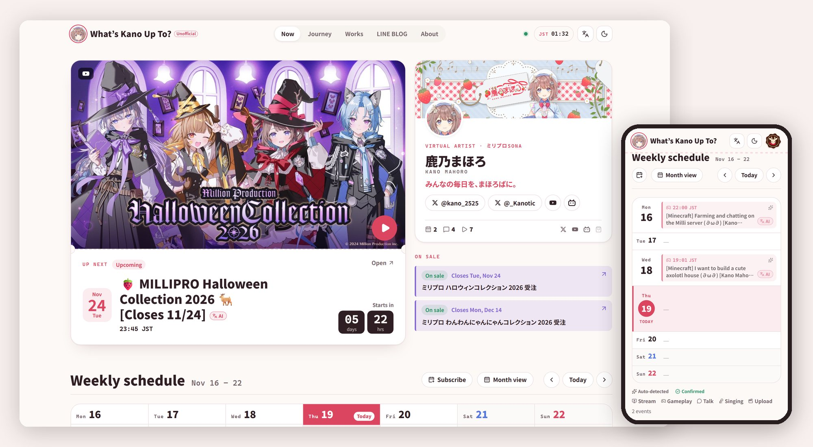
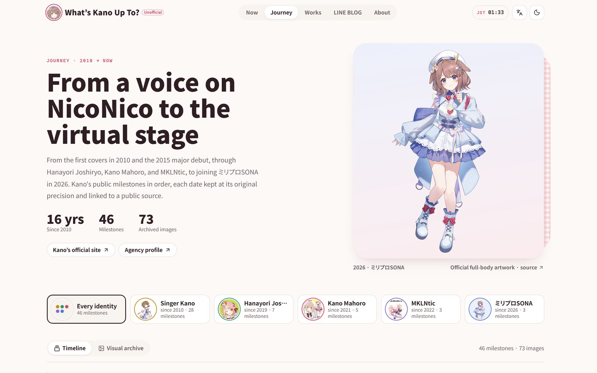
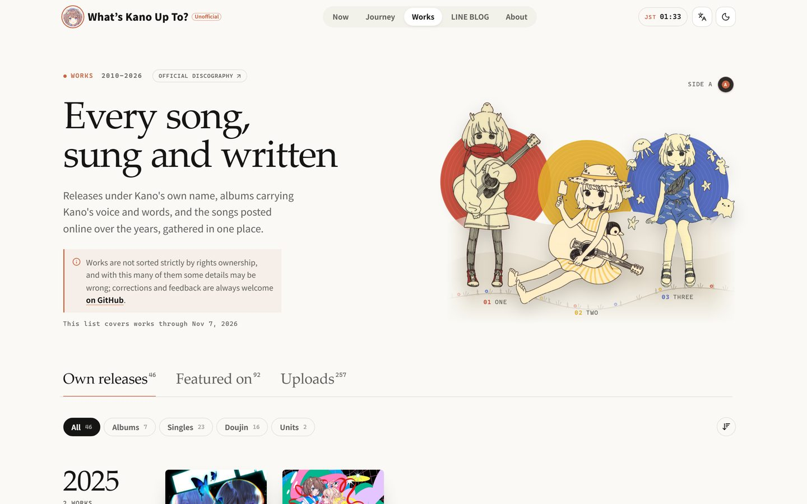

  

<h1 align="center">Kano Navi</h1>

  <b>What’s Kano Up To?</b> An unofficial fan board for Kano Mahoro (鹿乃まほろ).

  <a href="https://kano.fans/"><b>kano.fans</b></a> (Japan Server) ·
  <a href="https://xiaolubao.com/"><b>xiaolubao.com</b></a> (Mainland China Server provided by <a href="https://github.com/kanomahoro1224">Lu Ke</a>)

  
  
  

   
  Screenshots of the Japan Server in the light theme, captured on November 19, 2026 (JST).

> [!NOTE]
> Kano Navi is an independent fan project, not affiliated with or endorsed by
> Kano Mahoro, her agency, X, YouTube, bilibili, or LINE. Original
> announcements always take precedence.

## On the Site

| Page          | What it shows                                                                                                                                          |
| ------------- | ------------------------------------------------------------------------------------------------------------------------------------------------------ |
| **Now**       | The next stream with a countdown in Japan and local time, the weekly schedule and month view, recent posts from X and bilibili, and the latest videos. |
| **Journey**   | Her milestones since the first covers in 2010, by identity, and a visual archive with sources and credits.                                             |
| **Works**     | Her albums, singles, and doujin works with their editions, the works she is featured on, and every song she uploaded.                                  |
| **LINE BLOG** | Her 2015–2019 blog, restored with its photos and videos, in the blog's own layout and with Chinese and English translations.                           |

Every page reads in English, Japanese, and Simplified Chinese, in light and
dark themes, on phones and desktops. Schedule entries are marked
**Auto-detected** or **Confirmed**, and the schedule and new videos can be
followed from a calendar app or a feed reader. The
[User guide](docs/user/index.md) describes each page in detail.

<table>
  <tr>
    <td width="33%"></td>
    <td width="33%"></td>
    <td width="33%"></td>
  </tr>
  <tr>
    <td align="center">Journey</td>
    <td align="center">Works</td>
    <td align="center">LINE BLOG</td>
  </tr>
</table>

## Apps

- [Kano Navi for Apple](https://github.com/yexca/kano-navi-apple): the board
  as a native app for iOS, iPadOS, and macOS, by the board's author.
- [Kano Fans’ Treasure (小鹿包们的宝物)](https://dl.xiaolubao.com/): an app for
  Android, HarmonyOS, Windows, and iOS, by
  [Lu Ke](https://github.com/kanomahoro1224).

## Build and Run

The server collects public posts and videos on a schedule, reads schedule
entries from posts and schedule images, and keeps the result as a local
snapshot. Visitors only ever read that snapshot, so the board stays fast and
keeps the last known state when a platform is unavailable. The same snapshot
is open to other tools through a public read API and MCP.

| To                      | Start with                                                                                                                     |
| ----------------------- | ------------------------------------------------------------------------------------------------------------------------------ |
| Understand the system   | [How it works](docs/how-it-works.md) and [Architecture](docs/architecture/index.md)                                            |
| Read the data           | [Public API](docs/architecture/public-api.md)                                                                                  |
| Run an instance         | [Docker deployment](docs/operations/docker.md) and [Configuration](docs/operations/configuration.md)                           |
| Change the code         | [Local development](docs/development/local-dev.md), [Development](docs/development/index.md), and the [agent guide](AGENTS.md) |
| Report a vulnerability  | [Security](.github/SECURITY.md)                                                                                                |
| Find any other document | [Documentation index](docs/README.md)                                                                                          |

## Notice and License

Every post, video, and event links to its original public page, which is
always authoritative. Artwork, artist names, and other third-party content
keep their original rights, and the code license grants no rights to them;
image sources and credits are recorded with the
[history archive](docs/development/history-archive.md), the
[works collection](docs/development/works-archive.md), and the
[LINE BLOG archive](docs/development/lineblog-archive.md).

Created by [yexca](https://github.com/yexca). Kano Navi is free software
licensed under the [GNU Affero General Public License v3.0](LICENSE).
